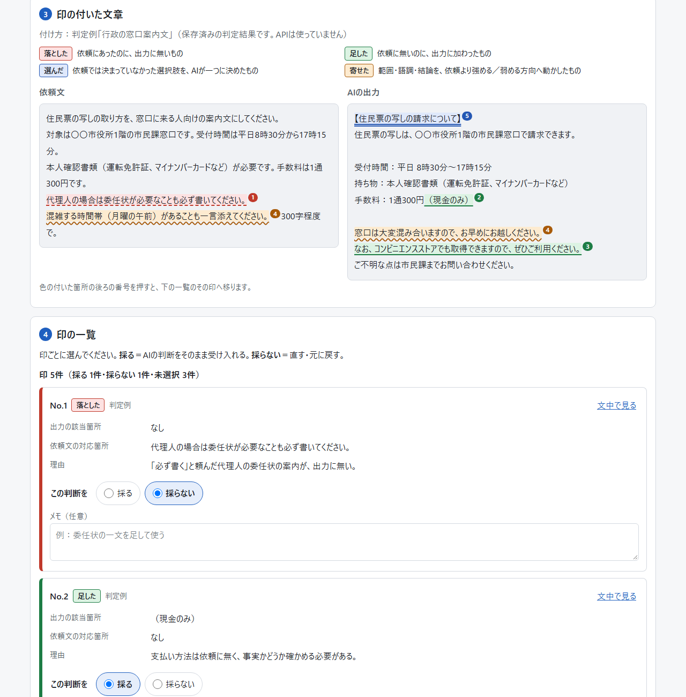
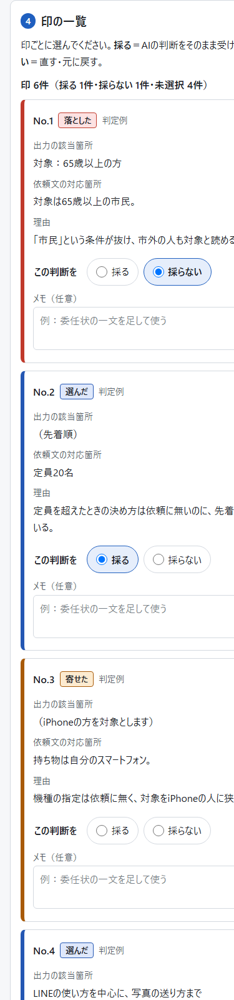

# AIが決めたことチェック（ai-decision-audit）

公開URL：https://takashi-101.github.io/ai-decision-audit/

判定例を開くと、鍵なしで使い方を確かめられます。

---

## 何をするツールか

AIに頼んだ文章（**依頼文**）と、AIが返した文章（**出力**）を並べて、出力の中で **「依頼文に書かれていないのに、AIが決めたこと」** に色で印を付けるWebツールです。
印を付けた箇所ごとに、その判断を **採る／採らない** を選び、メモを添えて、記録として保存（CSV・JSON）できます。

## 誰の、何の困りごとを解くか

AIを業務に使い始めた自治体・官公庁・NPOの職員の方に向けたツールです。

AIの出力は、読みやすく整っているほど、そのまま使ってしまいがちです。けれども出力には、頼んでいない案内が足されていたり、「必ず書いて」と頼んだことが抜けていたり、決めていなかった選択肢をAIが勝手に一つに決めていたりします。住民向けの案内文や庁内資料では、こうした小さな判断の違いが、誤案内や説明の食い違いにつながります。

このツールは、そうした「AIが頼まれずに決めたこと」を一つずつ見える形にし、人が採るか採らないかを決めて、その記録を残せるようにします。

## 印の種類（4つ）

| 印 | 意味 |
|---|---|
| **落とした** | 依頼にあったのに、出力に無いもの |
| **足した** | 依頼に無いのに、出力に加わったもの |
| **選んだ** | 依頼では決まっていなかった選択肢を、AIが一つに決めたもの |
| **寄せた** | 範囲・語調・結論を、依頼より強める／弱める方向へ動かしたもの |

印ごとに、**出力の該当箇所**（引用）、**依頼文の対応箇所**（無ければ「なし」）、**理由**（一行）を示します。
「落とした」は出力に無いものなので、依頼文の側に色が付きます。色だけでなく下線の形（点線・実線・二重線・波線）でも区別できます。

## 画面

PCで判定例を開いたところ（印の付いた文章と、印の一覧）



スマートフォンで印の一覧を見たところ



## 使い方

1. **文章を貼り付ける**：「依頼文」の欄にAIに頼んだ文章を、「AIの出力」の欄にAIが返した文章を貼り付けます。
2. **印を付ける**：次のどちらかを選びます。
   - **AIに判定させる**：AnthropicのAPI鍵を入れて「鍵を使う」を押し、「判定する」を押します。数十秒ほどで、出力に色の印が付きます。
   - **手で付ける**（鍵は不要）：「手で付ける」を押し、印の付いた文章をなぞって選びます。印の種類と理由を入れて「印を付ける」を押します。「落とした」は依頼文の側をなぞります。
3. **印の付いた文章を見る**：色の付いた箇所の後ろの番号を押すと、一覧のその印へ移ります。
4. **印の一覧で選ぶ**：印ごとに「採る」（AIの判断をそのまま受け入れる）か「採らない」（直す・元に戻す）を選び、必要ならメモを書きます。
5. **記録を書き出す**：「CSVで保存」（Excelで開けます）か「JSONで保存」を押すと、この端末にファイルが保存されます。

API鍵が無い場合は、画面上部の **「判定例を見る」** から、保存済みの判定例3件（行政の窓口案内文／庁内会議資料の要約／シニア向け講座の案内文）を開けます。例の文章はすべて架空のものです。

### 書き出す記録の中身

- **CSV**：番号、種類、出力の該当箇所、依頼文の対応箇所、理由、付け方（AIの判定／手で付けた／判定例）、判断（採る／採らない／未選択）、メモ
- **JSON**：上の内容に加えて、依頼文と出力の全文、書き出した日時、ツールの版

## データがどこへ行くか

- 依頼文・出力・印・「採る／採らない」・メモは、**使っている人のブラウザの外には出ません**。サーバーはありません。
- **例外は「判定する」を押したときだけ**です。そのとき、依頼文と出力が **AnthropicのAPI（api.anthropic.com）** へ送られます。送り先はそこだけで、ページの設定でもほかの送り先へは通信できないようにしています。
- **API鍵は保存しません。** 画面で入れた鍵は、開いているページの中だけに持ち、ページを閉じるか再読み込みすると消えます。ブラウザの保存領域（localStorage や Cookie）にも書きません。
- 判定に使うモデルは `claude-sonnet-5-5` です。
- 書き出した記録のファイルは、使っている人の端末に保存されるだけで、どこにも送られません。
- 判定例を開くとき・手で付けるときは、どこにも通信しません。

## 更新されたとき

画面の一番下に、ツールの版（例：`版 0.3.0`）が出ます。新しい版が公開されたら、ページを普通に開き直すと新しい版が出ます（読み込むファイルのURLに版の印を付けています）。公開直後は、反映まで数分かかることがあります。

## 動作の確かめ方（管理する人向け）

`test/` にテストがあります。本物のAPIには接続せず、Claude APIの応答の形をまねた仮の応答で、判定・形式の検証・再試行・エラー表示・判定例の表示・手で付ける・書き出しを確かめます。

- ブラウザで確かめる：このフォルダをローカルで配信し（例：`python -m http.server 8000`）、`http://localhost:8000/test/` を開きます。結果がページに一覧で出ます。
- コマンドで確かめる（Python と Chrome または Edge が必要）：

```bash
python test/run_tests.py
```

- 画面写真も撮る（375px と 1280px、ライト／ダーク。`test/screenshots/` に保存）：

```bash
python test/run_tests.py --shots
```

## ファイルの構成

| ファイル | 中身 |
|---|---|
| `index.html` | 画面 |
| `assets/style.css` | 見た目（ライト／ダーク） |
| `assets/audit-core.js` | 判定の中核（API呼び出し、返答の形式の検証と再試行、箇所の位置探し、書き出し） |
| `assets/app.js` | 画面の動き |
| `assets/examples.js` | 判定例3件（依頼文・出力・判定結果） |
| `test/` | テストと画面写真の撮影 |
| `docs/images/` | READMEの画面写真 |
